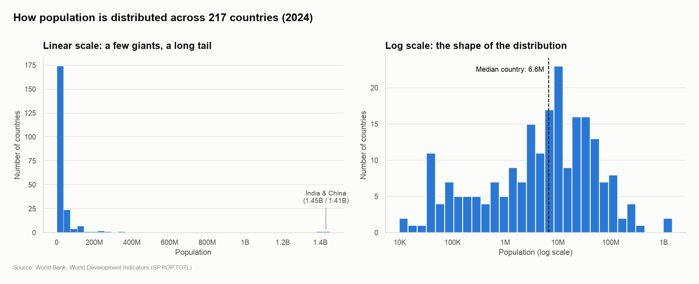
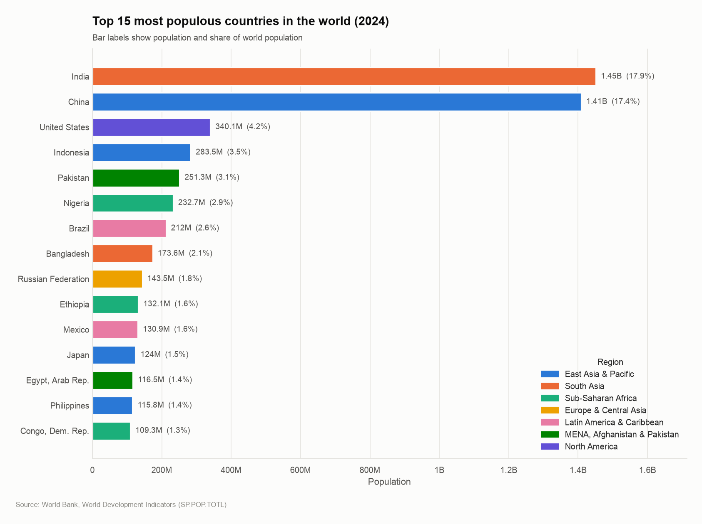
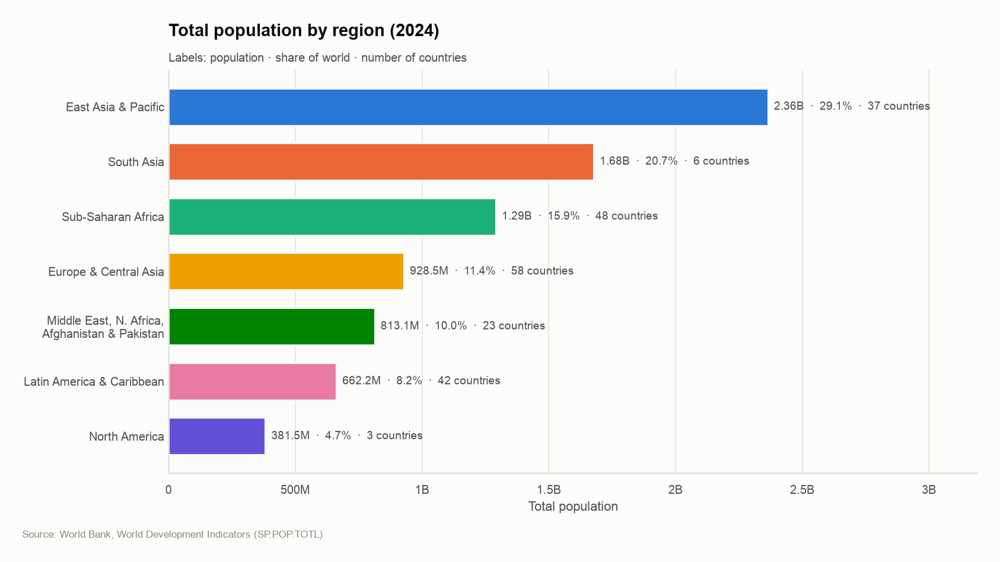
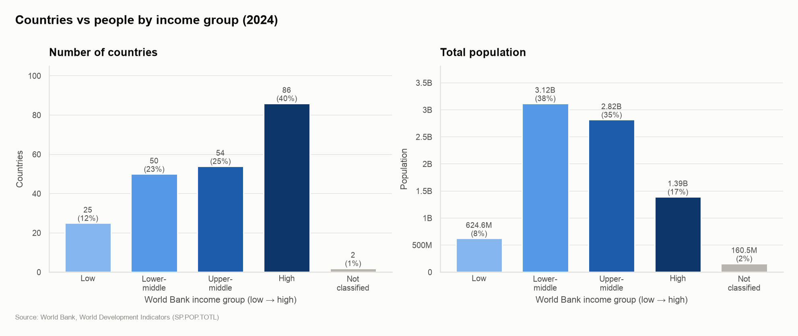
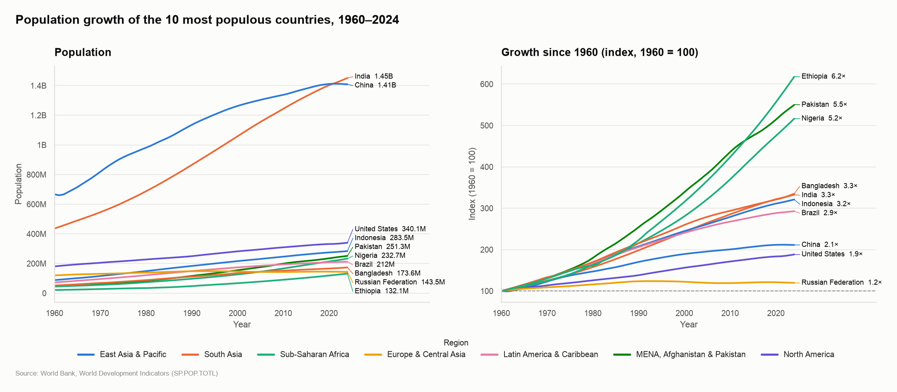
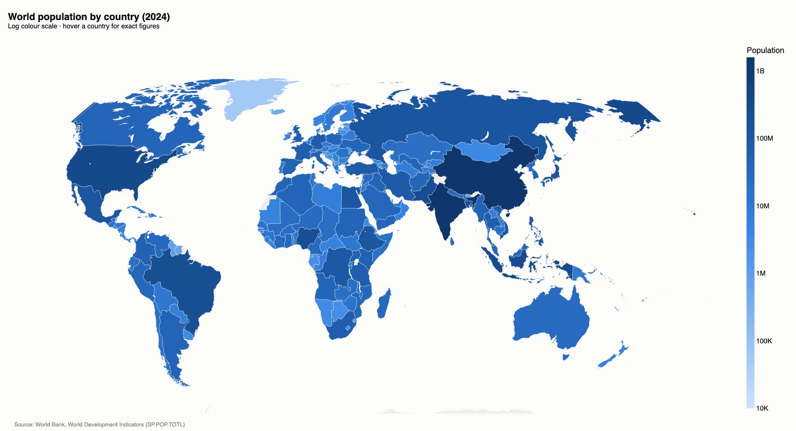

# 🌍 PopuLens: Visualizing How the World's Population Is Distributed

> **Prodigy InfoTech Data Science Internship – Task 01**
> Create bar charts and histograms to visualize the distribution of a categorical or continuous variable.

PopuLens takes the World Bank's total population indicator for **217 countries from 1960 to 2024**. It cleans the data into a tidy table and explains it with a set of consistent charts:

* **Histograms** of a continuous variable (country population, on linear and log scales)
* **Bar charts** of categorical variables (region, income group) and of the largest countries
* A **growth line chart** and an **interactive world map**

The project includes a storytelling notebook and an interactive **Streamlit** app.


---

## 📊 Key charts

| Distribution of country populations (histogram) |
|:--:|
|  |

| Top 15 most populous countries | Population by region |
|:--:|:--:|
|  |  |

| Countries vs people by income group |
|:--:|
|  |

| Growth of the 10 largest countries, 1960–2024 |
|:--:|
|  |

| World population map ([interactive version](reports/figures/06_world_population_map.html)) |
|:--:|
|  |

---

## 💡 Key insights (2024)

1. **Country sizes are extremely right-skewed.** The median country has **6.6M** people, but the mean is **37M**. A log-scale histogram is needed to see the real shape of the distribution: most countries have 1M–100M people, and there are 57 micro-states under 1M.
2. **Population is highly concentrated.** **India (1.45B) and China (1.41B) hold 35%** of humanity. The top 10 countries hold **57%**, while the smallest 108 countries together hold **2.4%**.
3. **India overtook China in 2021** (World Bank series). China's population peaked that year and is now slowly declining.
4. **South Asia holds 1 in 5 people on Earth in just 6 countries.** Europe & Central Asia has the most countries (58) but only 11% of the population.
5. **Most countries are rich, but most people are not.** High-income economies are **40% of countries but 17% of people**. **73%** of humanity lives in middle-income countries.
6. **Growth is shifting south.** Sub-Saharan Africa's share of world population **doubled** since 1960 (7.6% → 15.9%), while Europe & Central Asia's **halved** (22.2% → 11.4%). Among the 10 largest countries, Ethiopia grew **6.2×**, while Russia grew only **1.2×**.
7. **The world grew 2.7×**, from 3.0B in 1960 to 8.1B in 2024.

---

## 📁 Dataset

**Source:** World Bank, World Development Indicators, *Population, total* (`SP.POP.TOTL`)
- Original: <https://data.worldbank.org/indicator/SP.POP.TOTL>
- Internship copy: <https://github.com/Prodigy-InfoTech/data-science-datasets/tree/main/Task%201>

| File | Contents |
|---|---|
| `API_SP.POP.TOTL_DS2_en_csv_v2_38144.csv` | Population per country/aggregate, one column per year (1960–2024), 4 metadata lines at the top |
| `Metadata_Country_…csv` | `Region` and `IncomeGroup` per country code |
| `Metadata_Indicator_…csv` | Definition of the indicator (de facto, mid-year estimates) |

### Cleaning decisions

| # | Decision | Why |
|---|---|---|
| 1 | Skip 4 metadata lines; drop empty `Unnamed` and constant `Indicator` columns | They hold no data |
| 2 | Keep only codes with a `Region` in the metadata | Removes **48 aggregates** ("World", "Euro area", "High income", …) and the empty `INX` row |
| 3 | Reshape years from wide to long → `country, code, region, income_group, year, population` | Tidy format for analysis |
| 4 | **No imputation** of missing population. Drop the 30 missing country-years (West Bank and Gaza, 1960–89) | Invented headcounts would be misleading |
| 5 | Missing `IncomeGroup` (Ethiopia, Venezuela) → `"Not classified"` | Keeps 160M people in every total |

The 217 remaining countries sum to within **0.3%** of the World Bank's own "World" total.

---

## 🗂️ Project structure

```
PopuLens/
├── data/
│   ├── raw/                      # Original World Bank CSVs
│   └── processed/                # population_long.csv (tidy, generated)
├── notebooks/
│   └── PopuLens_analysis.ipynb   # Storytelling analysis (executed)
├── src/
│   ├── __init__.py
│   ├── data_loader.py            # Paths, raw loaders, inspection helper
│   ├── cleaning.py               # Cleaning pipeline + CleaningReport
│   └── visualize.py              # Shared style, formatters, all charts
├── reports/
│   └── figures/                  # Exported PNGs + interactive map HTML
├── .streamlit/config.toml        # App theme
├── app.py                        # Streamlit app
├── requirements.txt
├── LICENSE
└── README.md
```

---

## ⚙️ Setup

Requires **Python 3.11+** (pandas 3.x does not support 3.10). Tested on Python 3.14.

```bash
git clone https://github.com/VaishnavK9/PopuLens.git
cd PopuLens
python3 -m venv .venv
source .venv/bin/activate          # Windows: .venv\Scripts\activate
pip install -r requirements.txt
```

## ▶️ How to run

**1. Rebuild the clean dataset and all figures**

```bash
python -m src.cleaning      # writes data/processed/population_long.csv
python -m src.visualize     # writes reports/figures/*.png and the map .html
```

The map PNG uses `kaleido`, which needs Google Chrome or Chromium installed. Without one, the PNG is skipped and the interactive HTML map is still saved.

**2. Open the notebook**

```bash
jupyter notebook notebooks/PopuLens_analysis.ipynb
```

**3. Launch the Streamlit app**

```bash
streamlit run app.py
```

The app lets you pick a **year** (1960–2024), one or more **regions**, and a **chart type** (histogram, top countries, region, income group, growth or map). It shows headline metrics, the chart, and the underlying data with a CSV download.

---

## 🎨 Design choices

* **One visual system.** The same style, source footnote and number format (12.3K · 340.1M · 1.45B) are used everywhere.
* **Color follows the entity.** Each region keeps the same color in every chart. The palette is checked for color-vision-deficiency safety, and income groups use an ordered blue ramp.
* **No dual axes.** Different measures (countries vs people, absolute vs indexed growth) get side-by-side panels.
* **Log scales where the data needs them.** Both the histogram and the map use a log scale, because populations range from about 10K to 1.45B.

---

## 🛠️ Tech stack

| Purpose | Tools |
|---|---|
| Data | Python, pandas, NumPy |
| Static charts | Matplotlib, Seaborn |
| Interactive charts | Plotly (+ Kaleido for PNG export) |
| App | Streamlit |
| Notebook | Jupyter |

---

## 👤 Author

**Vaishnav Kumbhar**
GitHub: [@VaishnavK9](https://github.com/VaishnavK9)

Built as **Task 01** of the **Prodigy InfoTech Data Science Internship**.

## 📄 License

This project is licensed under the [MIT License](LICENSE). Data © World Bank, licensed under [CC BY 4.0](https://datacatalog.worldbank.org/public-licenses#cc-by).
